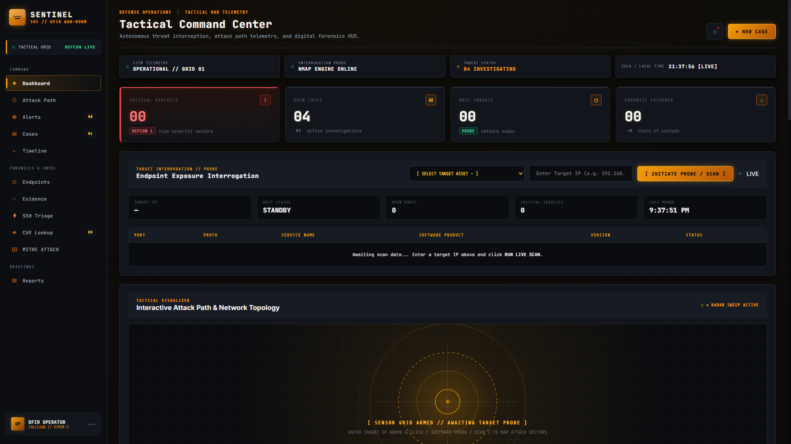
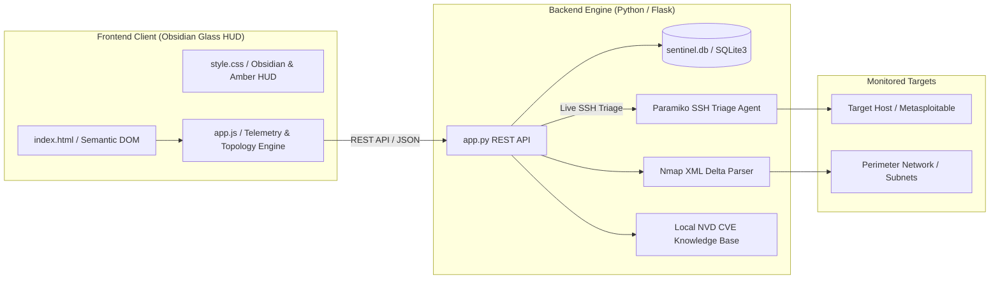

# SENTINEL SOC // DFIR Tactical Command Center

<p align="center">
  
</p>

<p align="center">
  
  
  
  
  
</p>

---

## Overview

SENTINEL is a military-grade Security Operations Center (SOC) & Digital Forensics / Incident Response (DFIR) Tactical War-Room Dashboard.

Engineered for SOC tier-2/3 analysts, threat hunters, and incident response teams, SENTINEL consolidates perimeter attack surface scanning, automated CVE intelligence correlation, live remote host forensics, and executive incident reporting into a single unified dark-obsidian telemetry console.

---

## Key Features

### 1. Interactive Attack Path & Network Topology (SVG)
- Dynamic Vector Mapping: Real-time visual network topology rendering the full attacker-to-host exploitation chain.
- Pulsing Compromise Nodes: Live radar-sweep background with animated risk nodes identifying vulnerable exposed ports and remote execution vectors.
- Node Inspection: Clickable SVG nodes exposing protocol banners, service versions, and associated CVSS threat ratings.

### 2. Live Remote Host Forensic Triage (SSH Agent)
- Direct OS-Level Telemetry: Integrated SSH triage collector (Paramiko) with instant safe fallback for rapid response.
- .bash_history Recon: Live stream and audit of executed adversary shell commands on the target host.
- UID 0 Account Auditing: Automated detection of rogue root clones and unauthorized backdoor users in /etc/passwd.
- Staging Area Inspection: Live surveillance of /tmp and /var/tmp for dropped payloads, webshells, or staging scripts.

### 3. CVE Exploit Correlation Matrix
- Automated local NVD correlation mapping live service banners (e.g. vsftpd 2.3.4, Apache 2.2.8, DistCC, UnrealIRCd) directly to actionable CVEs, CVSS severity scores, and Metasploit exploit modules.

### 4. Multi-Target Asset Switcher
- Instantly switch telemetry focus across multiple lab assets and subnets:
  - 192.168.70.130 (Metasploitable 2 Linux Target)
  - 192.168.1.9 (Workstation Endpoint)
  - 192.168.70.1 (Security Gateway)
  - Manual CIDR / IP entry with single-click scanning.

### 5. Executive Briefing & Incident PDF Export
- 1-Click print-ready classified incident brief formatted for CISO and senior leadership review.
- Includes SOC classification markings, active DEFCON threat level, executive summaries, MITRE matrix mapping, and structured remediation playbooks.

### 6. Integrated Case Management System
- Persistent SQLite-backed incident triage database.
- Real-time case logging, severity categorization (CRITICAL, HIGH, MEDIUM, LOW), investigator assignment, and status workflows (OPEN, INVESTIGATING, CONTAINED, CLOSED).

### 7. Live Mission Clock & Telemetry HUD
- Real-time war-room digital clock (HH:MM:SS [LIVE]) synchronized down to the second.
- Defense-ready Obsidian & Amber Gold palette engineered for zero optical fatigue in darkened tactical rooms.

---

## Architecture & Tech Stack



- Frontend: Pure Vanilla JavaScript (ES6+), Semantic HTML5, Hardware-accelerated SVG Vector Graphics, Zero-dependency Charting & UI.
- Backend API: Python 3, Flask, Flask-CORS.
- Host Forensics: Paramiko (SSHv2 protocol communication).
- Network Recon: Nmap differential XML parser.
- Database: SQLite3 with automated schema migrations.

---

## Quick Start & Installation

### 1. Prerequisites
- Python: 3.8 or higher installed
- Git: Installed on your system
- Nmap: Optional, for live network scanning

### 2. Clone the Repository
```bash
git clone https://github.com/ALYANXG/SOC-DFIR-Dashboard.git
cd SOC-DFIR-Dashboard
```

### 3. Install Dependencies
```bash
pip install -r requirements.txt
```

### 4. Launch the Platform
```bash
python Backend/app.py
```

### 5. Access the Command Center
Open your browser and navigate to:
```
http://localhost:5000/dashboard
```

---

## REST API Specification

| Endpoint | Method | Description |
|---|:---:|---|
| /dashboard | GET | Main SOC tactical war-room application |
| /api/status | GET | Health status of backend engines, database, and telemetry |
| /api/scan | GET | Parsed port telemetry, vulnerability classifications & deltas |
| /api/cve | GET | Automated CVE correlation engine for discovered services |
| /api/triage | GET | Live remote host forensics (.bash_history, /etc/passwd, /tmp) |
| /api/cases | GET / POST | Query active incident cases or create new triage tickets |
| /api/cases/<id> | PUT / DELETE | Update case status/notes or remove resolved cases |
| /api/alerts | GET | Real-time threat detection alerts and anomalous delta triggers |
| /api/mitre | GET | MITRE ATT&CK technique and tactic coverage mapping |
| /api/run-scan | POST | Trigger targeted tactical Nmap reconnaissance on an IP |

---

## Target Lab Testing (Metasploitable 2)

To test the live forensic triage and exploit analysis against a vulnerable target in your private lab:

1. Launch your Metasploitable 2 VM (e.g. 192.168.70.130).
2. Select Metasploitable 2 from the top HUD Asset Switcher or input the IP into the Tactical Target bar.
3. Click Initiate Probe / Scan.
4. Observe:
   - Dynamic SVG Attack Path illuminating compromised ports (21 FTP, 22 SSH, 80 HTTP, 3632 DistCC).
   - CVE Exploit Matrix displaying critical CVEs (e.g. CVE-2011-2523, CVE-2004-2687).
   - Host Triage box detailing active bash history commands and rogue root user audits.
   - Click Export Briefing to generate an immediate classified PDF for your incident report.

---

## License
This project is released under the MIT License. Engineered for educational, defensive research, and authorized incident response testing only.

---

<p align="center">
  <b>SENTINEL SOC TACTICAL COMMAND CENTER // ZERO COMPROMISE DEFENSE</b>
</p>
